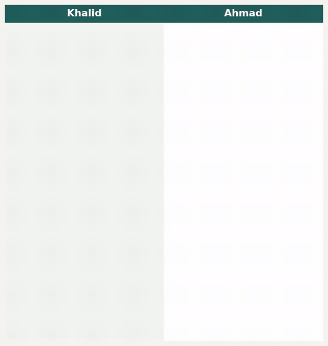
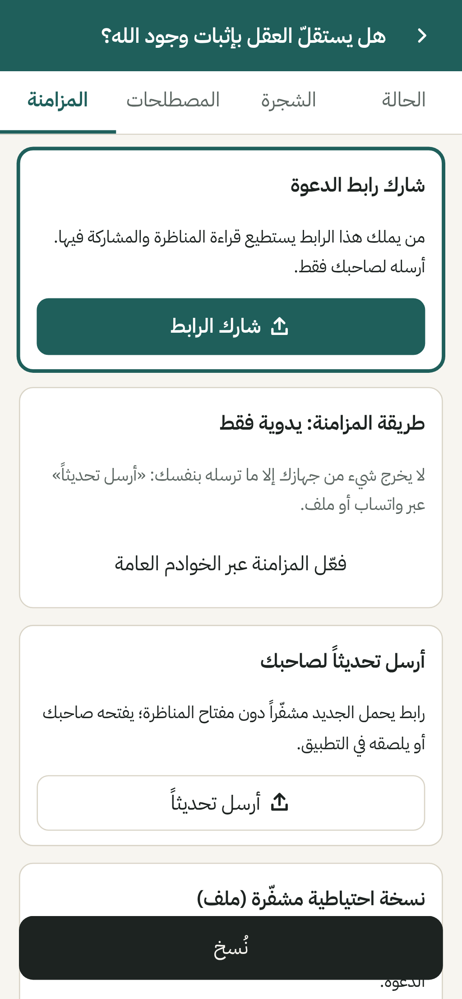
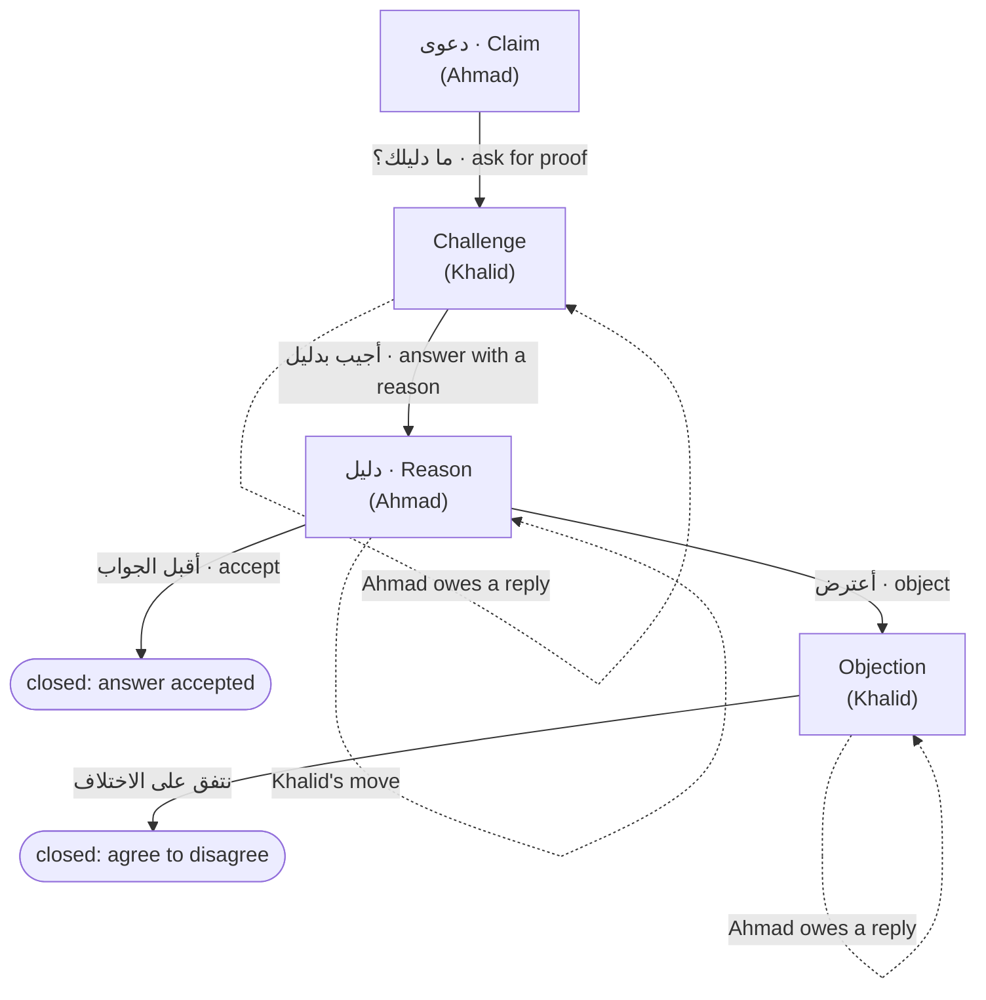
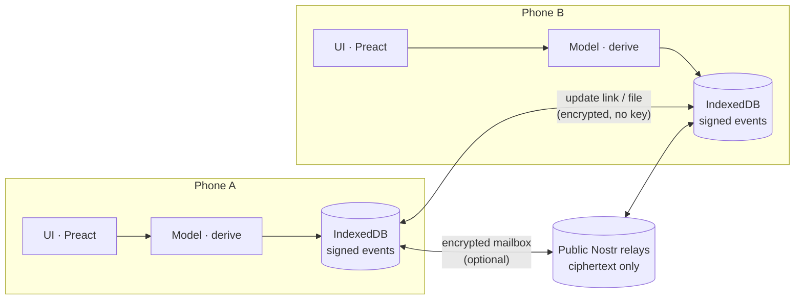

<div align="center">


# مناظرة · Munazara

**مناظرة منظّمة بين الأصدقاء — كل نقطة في مكانها، وكل رد معلوم صاحبه**<br>
**Structured debates between friends — every point in its place, every reply accounted for**

[](https://github.com/Ahmad-Nayfeh/Repo-B/actions/workflows/ci.yml)
[](LICENSE)


[**🌐 Live site**](https://ahmad-nayfeh.github.io/Repo-B/) <sup>(goes live once GitHub Pages is switched on)</sup> · [العربية](#-بالعربية) · [English](#-in-english) · [Demo](#-demo) · [How it works](#-how-it-works) · [Privacy](#-privacy) · [Development](#-development)

</div>

---

## 🎬 Demo

<div align="center">



*Two phones, real app: Ahmad (right) starts a debate and shares the link → Khalid (left) joins and asks «ما دليلك؟» (what is your proof?) → Ahmad sees **«عليك الرد»** (you owe a reply) and answers → Khalid now sees **«دورك»** (your move).*
[▶ Watch as MP4](docs/media/demo.mp4)

</div>

---

## 🇸🇦 بالعربية

### المشكلة
المناظرات الطويلة — في الإيمان، ووجود الله، وحجية العقل — تجري اليوم في رسائل واتساب الصوتية: **تضيع الحجج، وتبقى نقاط بلا جواب دون أن ينتبه أحد، وتنزاح معاني المصطلحات، ولا يرى أحدٌ حالَ المناظرة إجمالاً.**

### الحل
| | |
|---|---|
| 🌳 **شجرة لا محادثة** | كل ردّ مرتبط بالنقطة التي يرد عليها: الدعوى، وتحتها أدلتها، والاعتراضات، والأجوبة، والتسليم. |
| ⏳ **«بانتظارك» أولاً** | أول ما تراه: النقاط التي **عليك الرد** عليها، والنقاط التي صار **دورك** فيها بعد أن أجاب صاحبك — ومثلها لصاحبك بالقدر نفسه. |
| 🔇 **لا شيء يُغلق بالسكوت** | النقطة المفتوحة تبقى مفتوحة حتى يُجاب عنها أو يُسلَّم بها أو تُسحب أو تتفقا على الاختلاف فيها. |
| 📜 **حركات آداب البحث والمناظرة** | الاستفسار، والمنع وطلب الدليل، والمنع مع السند، والنقض بشاهد، والمعارضة، وطلب تصحيح النقل، وتحرير المراد، والتسليم. |
| 📖 **المصطلحات** | تعريفات متفق عليها أو محل خلاف، ومرجع موثّق للمغالطات والمفاهيم المسمّاة — يُسأل عنها سؤالاً لا اتهاماً. |
| ⚖️ **لا يحكم لأحد** | لا نقاط ولا تصويت ولا «فائز». الأداة تنظّم الحوار فقط. |
| 🔒 **خاص افتراضياً** | لا حسابات، ولا إحصاءات، ولا متتبّعات. المناظرة على جهازك ومشفّرة طرفاً لطرف، والمفتاح في رابط الدعوة فقط. |
| 📱 **للهاتف أولاً** | عربي أولاً مع الإنجليزية، يعمل دون اتصال بعد أول زيارة، ويُثبَّت على الشاشة الرئيسية. |
| 💸 **مجاني بالكامل** | لا خادم خاص، ولا اشتراكات، ولا إعلانات. |

### كيف أبدأ؟
1. افتح [الموقع](https://ahmad-nayfeh.github.io/Repo-B/) ← **«مناظرة جديدة»**.
2. اكتب السؤال محل النزاع ودعواك واسمك.
3. **«شارك الرابط»** وأرسله لصاحبك على واتساب — هذا كل شيء.

---

## 🇬🇧 In English

### The problem
Long debates — about faith, God's existence, the authority of reason — happen today in WhatsApp voice notes: **arguments get lost, points go unanswered without anyone noticing, terms drift, and nobody can see the state of the debate.**

### What Munazara does
| | |
|---|---|
| 🌳 **A tree, not a chat** | Every reply is attached to the point it answers: claims with their reasons, objections, answers and concessions. |
| ⏳ **"Waiting on you" first** | The first screen shows what **you owe a reply** on, and where it is **your move** after your friend answered — shown symmetrically for both people. |
| 🔇 **Silence closes nothing** | An open point stays open until it is answered, conceded, withdrawn, or you agree to disagree. |
| 📜 **Classical disputation moves** | From *ādāb al-baḥth wa-l-munāẓara*: clarification, denial / request for proof, objection with a ground, refutation with a witness, counter-argument, authenticate the citation, clarify meaning, concession. |
| 📖 **Terms** | Agreed or disputed definitions, plus a sourced reference of named fallacies and concepts — raised as questions, never accusations. |
| ⚖️ **Never judges** | No scores, votes or "winner". The tool structures; people decide. |
| 🔒 **Private by default** | No accounts, analytics or trackers. The debate lives on your device, end-to-end encrypted; the key exists only in the invite link. |
| 📱 **Mobile-first** | Arabic-first with English, offline after the first visit, installable. |
| 💸 **Free** | No server of ours, no subscriptions, no ads. |

---

## 📸 Screenshots

<div align="center">

| What is waiting on you | The tree, focused on one point | Replying with a move |
|:---:|:---:|:---:|
|  |  |  |
| **Invite & sync** | **English interface** | **Dark mode** |
|  |  |  |

</div>

---

## 🧭 How it works

### The debate model
Each point (node) is **one move by one author**, and every move replies to exactly one earlier point. Statuses and obligations are **computed**, never stored — so two phones with the same points always show the same state.



### Classical moves → buttons
| آداب البحث والمناظرة | Button in the app | Effect |
|---|---|---|
| الاستفسار | «ماذا تقصد؟» | The author owes a clarification |
| المنع المجرد / طلب الدليل | «ما دليلك؟» | The author owes a proof |
| المنع مع السند | «أعترض» (with a reason) | The author owes a reply |
| النقض بشاهد (تخلّف / استلزام المحال) | «نقض» + witness type | Must name a counter-case or an impossibility |
| المعارضة | «معارضة» | A counter-claim with its proof; roles swap |
| طلب تصحيح النقل | «وثّق النقل» | For quotes the author does not personally endorse |
| تحرير المراد | «أوضّح مقصدي» | Answers a clarification request |
| التسليم | «أقبل الجواب» / «أتراجع عن هذه النقطة» | Closes the thread |
| — (adaptation) | «نتفق على الاختلاف هنا» | Both must agree; one-sided proposals pass the move |

**Fairness by design:** obligations are symmetric ("you owe" *and* "your move" for both people), ten challenges on one point count once, nothing closes by silence, and no label ever says who is right. The full rule table is in [`docs/design/PRD.md`](docs/design/PRD.md) §3.

### Architecture

- **No server of ours.** A static site on GitHub Pages.
- **Local-first:** every device keeps the whole debate as an append-only log of **signed** events (ECDSA P-256).
- **End-to-end encryption:** AES-256-GCM; the key lives only in the invite link's `#fragment`, which browsers never send to servers.
- **Two sync modes:** *manual* (send an update link or file via WhatsApp — nothing else leaves the phone) or *encrypted relay mailbox* (public Nostr relays store ciphertext only).

---

## 🔐 Privacy

| Data | Where | Who can read it |
|---|---|---|
| The debate | Your device (browser storage) | Whoever can unlock your device |
| Copies in transit (relay mode only) | Public Nostr relays | Nobody without the link; relays see timing, size, IP |
| The key | The invite link and wherever you send it | Anyone with the invite link |
| Your visit | GitHub Pages logs IPs | GitHub |

No analytics · no trackers · no third-party scripts or fonts · `noindex` · strict CSP. Full details and honest limits: [`docs/PRIVACY.md`](docs/PRIVACY.md).

---

## ✅ Quality

| Check | Result |
|---|---|
| Unit tests (model, fairness fixtures, crypto, links, storage, i18n) | 41 passing |
| End-to-end (two people on two phones, relay sync via mock relays, offline, accessibility, 300-point debate) | passing in CI |
| Manual mode network isolation | 0 requests to other hosts |
| Accessibility (axe, WCAG 2.2 AA tags, light + dark) | 0 serious/critical violations |
| 300-point debate, 4× CPU throttle | status 478 ms, LCP 440 ms |
| First-load JavaScript | ≈ 40 KiB gzip |

---

## 🛠 Development

```bash
npm ci
```
```bash
npm run dev
```
```bash
npm test
```
```bash
npm run build && npm run e2e
```

| Path | What |
|---|---|
| `src/model/` | Validity matrix and the status / obligation engine |
| `src/crypto/` | HKDF, AES-GCM, ECDSA signatures |
| `src/sync/` | Links, backup format, Nostr mailbox |
| `src/store/` | IndexedDB |
| `src/ui/`, `src/i18n/` | Screens; Arabic and English strings |
| `tests/` | Vitest unit tests, Playwright e2e |

**How this was built** — research first, then design, then code, each gated by an independent review:
[`research/SYNTHESIS.md`](research/SYNTHESIS.md) (argumentation theory, the munazara tradition, existing tools, mobile UX, sync feasibility, voice) ·
[`docs/org/`](docs/org) (department charters and quality gates) ·
[`docs/design/`](docs/design) (PRD, architecture, reviews) ·
[`docs/DECISIONS.md`](docs/DECISIONS.md) ·
[`docs/STATUS.md`](docs/STATUS.md) ·
[`docs/ROADMAP.md`](docs/ROADMAP.md).

---

<div align="center">

MIT licence · Font: IBM Plex Sans Arabic (SIL OFL 1.1)

*«أن يقصد كلٌّ منهما ظهور الحق، ولو على يد خصمه»* — from the classical etiquette of disputation

</div>
