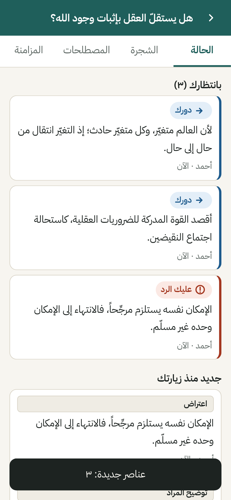
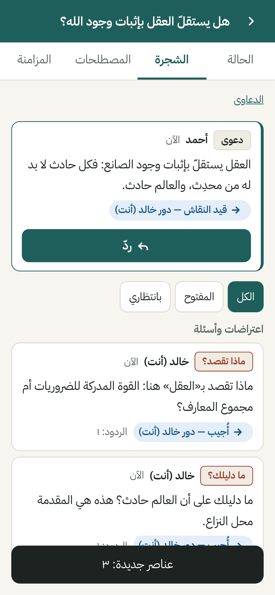
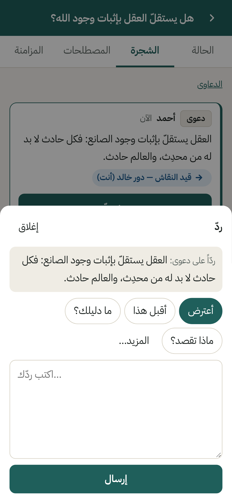
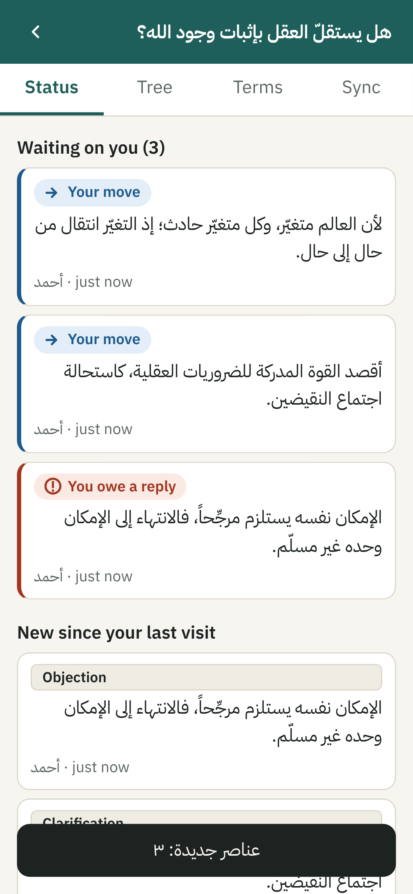
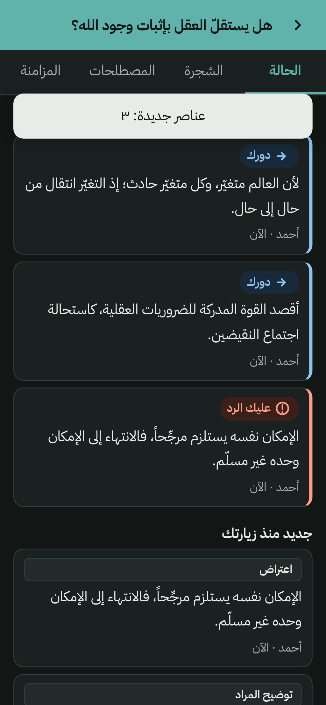

# مناظرة · Munazara

**موقع مجاني لمناظرة منظّمة بين الأصدقاء: كل نقطة في مكانها، وكل رد معلوم صاحبه.**
*A free site for structured debates between friends: every point in its place, every reply accounted for.*

> الرابط (بعد تفعيل GitHub Pages، انظر `docs/NEEDS-AHMAD.md`): **https://ahmad-nayfeh.github.io/Repo-B/**

<p>



</p>

## بالعربية

**لماذا؟** المناظرات الطويلة في رسائل واتساب الصوتية تضيع فيها الحجج، وتبقى نقاط بلا جواب دون أن ينتبه أحد، وتنزاح معاني المصطلحات، ولا يرى أحدٌ حالَ المناظرة إجمالاً.

**ماذا يفعل الموقع؟**
- **كل ردّ مرتبط بما يرد عليه**: الدعوى وتحتها أدلتها والاعتراضات عليها والأجوبة والتسليم.
- **«بانتظارك»**: أول ما تراه هو النقاط التي عليك الرد عليها، والنقاط التي صار «دورك» فيها بعد أن أجاب صاحبك — ومثلها لصاحبك بالقدر نفسه. لا شيء يُغلق بالسكوت.
- **حركات المناظرة الكلاسيكية** من آداب البحث والمناظرة: الاستفسار («ماذا تقصد؟»)، المنع وطلب الدليل («ما دليلك؟»)، الاعتراض مع السند، النقض بشاهد (تخلّف أو استلزام محال)، المعارضة، طلب تصحيح النقل، تحرير المراد، التسليم، والاتفاق على الاختلاف.
- **المصطلحات**: تعريفات متفق عليها أو محل خلاف، ومرجع صغير للمغالطات والمفاهيم المسمّاة (يُسأل عنها سؤالاً لا اتهاماً).
- **لا يحكم لأحد**: لا نقاط ولا تصويت ولا «فائز».
- **خاص افتراضياً**: لا حسابات ولا إحصاءات ولا متتبّعات؛ المناظرة محفوظة على جهازك ومشفّرة طرفاً لطرف؛ المفتاح في رابط الدعوة فقط. التفاصيل في `docs/PRIVACY.md`.
- **مجاني بالكامل** ويعمل دون اتصال بعد أول زيارة، ومصمَّم للهاتف أولاً.

**كيف أبدأ؟** افتح الموقع ← «مناظرة جديدة» ← اكتب السؤال ودعواك ← «شارك الرابط» وأرسله لصاحبك.

## In English

**Why?** Long debates in WhatsApp voice notes lose arguments, leave points unanswered without anyone noticing, let terms drift, and give nobody an overview.

**What it does**
- Every reply is attached to the point it answers: claims with their reasons, objections, answers and concessions.
- **"Waiting on you"** first: points you owe a reply on, and points where it is "your move" after your friend answered — shown symmetrically for both people. Silence never closes anything.
- **Classical disputation moves** from *ādāb al-baḥth wa-l-munāẓara*: clarification request, denial / request for proof, objection with a ground, refutation with a witness, counter-argument, request to authenticate a citation, clarification of meaning, concession, agree to disagree.
- **Terms**: agreed or disputed definitions, plus a small sourced reference of named fallacies and concepts.
- **Never judges**: no scores, votes or "winner".
- **Private by default**: no accounts, analytics or trackers; the debate lives on your device, end-to-end encrypted; the key exists only in the invite link. See `docs/PRIVACY.md`.
- **Free**, works offline after the first visit, mobile-first, Arabic-first with English.

<p> </p>

## For developers

```bash
npm ci
```
```bash
npm run dev
```
```bash
npm test
```
```bash
npm run build && npm run e2e
```

- Stack: TypeScript, Preact + signals, Vite; Vitest + Playwright; no backend. First-load JS ≈ 40 KiB gzip.
- Code map: `src/model` (validity matrix + status/obligation engine), `src/crypto`, `src/sync` (links, Nostr mailbox), `src/store` (IndexedDB), `src/ui`, `src/i18n`.
- Design trail: `research/` (with `SYNTHESIS.md`), `docs/org/`, `docs/design/`, `docs/DECISIONS.md`. Current state: `docs/STATUS.md`. Next steps: `docs/ROADMAP.md`.
- Data format: `docs/FORMAT.md`.

Licence: MIT (code). Font: IBM Plex Sans Arabic, SIL Open Font License 1.1 (`public/fonts/`).
